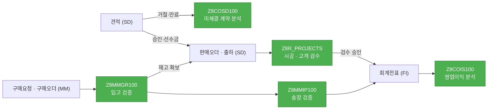

# ☀️ SAP_Solar_Proj
 
> **B2B 태양광 유통·시공 프로세스 통합을 위한 SAP 시스템 구축**
> SeSAC(청년취업사관학교) 금천 캠퍼스 클라우드 ABAP 개발자 6기 · 8조 **이팔청춘**
 
| 항목 | 내용 |
|---|---|
| 기간 | 2026.09.07 ~ 2026.11.08 |
| 인원 | 5명 |
| 모듈 | SD · PS · MM · FI · CO |
| 개발 환경 | SAP ABAP (Dynpro, OO ALV), RAP · CDS · Fiori Elements, abapGit |
 
---
 
## 🎬 데모 · 발표자료
 
| 구분 | 링크 |
|---|---|
| 시연 영상 | [8조_발표영상.mp4](docs/Video/8조_발표영상.mp4) |
| 발표자료 | [이팔청춘_발표자료.pdf](docs/PPTX/이팔청춘_발표자료.pdf) |
| 완료보고서 | [이팔청춘_완료보고서.pdf](docs/PPTX/이팔청춘_완료보고서.pdf) |
 
---
 
## 📌 프로젝트 개요
 
**인피니티솔라(Infinity Solar)**는 고효율 태양광 기자재 유통부터 현장 실사·견적, 발전설비 설치·시공까지 제공하는 가상의 B2B 기업입니다(본사 경기 화성, 지사 평택·진천·구미·나주).
 
RE100·탄소중립 대응으로 기업의 태양광 설비 도입이 늘어나는 가운데, 수기·이메일 중심으로 나뉘어 있던 업무를 SAP ERP로 통합하는 것을 목표로 했습니다.
 
| AS-IS | TO-BE |
|---|---|
| 주문을 엑셀로 관리하고 자재 요청을 이메일로 전달해 오기 발생 | 수주 → 발주 → 납품 → 청구 전체 오더 사이클 자동화 |
| 판매·청구·입금 정보가 분리되어 매출·미수금 관리 비효율 | 판매·청구·회계 연계로 매출과 미수금 통합 관리 |
| 설치 요청·기사 배정이 별도 관리되고 현장 진행상황 공유 불가 | 설치 정보를 실시간 연계해 기사 배정과 설치 현황 통합 관리 |
| 부족 자재 파악과 재고 보충이 수작업 | 보충 수량 산정과 구매요청 생성 자동화 |
 
---
 
## 👥 팀 구성 및 역할
 
| 이름 | 담당 모듈 | 주요 담당 |
|---|---|---|
| 박지우 | PL / SD · FI · PS | 전체 일정, 일수 관리 및 영업, 출고 개발 |
| 박수지 | PM / MM · SD | 재고, 구매요청, 청구 개발 및 구매 데이터 검증 |
| 이규빈 | MM | 구매조달, STO 및 자재 이동 배치 개발 |
| 박주연 | FI | 회계 흐름 설계, 전표/채권채무 개발 및 발표 |
| **구동준** | MM · SD · CO | 입고·송장 검증, 시공 고객 검수, 영업이익·기회손실 분석, 프로젝트 발표 |
 
> 이 README에서 상세히 소개하는 5개 프로그램은 **구동준**이 개발·문서화한 프로그램입니다.
 
---
 
## 🔄 전체 프로세스 흐름
 

 
<!-- 원본 흐름도 이미지를 함께 보여주려면 아래 경로에 이미지를 올리세요. -->
<!--  -->
 
초록색 박스가 이 README에서 소개하는 프로그램입니다. 구매·입고로 재고를 확보하고(MM), 시공과 고객 검수로 매출을 인식한 뒤(PS · SD · FI), 쌓인 데이터로 손익과 기회손실을 분석(CO)하는 흐름입니다.
 
---
 
## 🧩 주요 프로그램
 
| 프로그램 | 모듈 | 기능 | 주요 기술 |
|---|---|---|---|
| **Z8MMGR100** | MM | 구매오더 자재 검수 후 정상입고(105) · 반품(124) 처리, 자재문서 · PO 이력 · 입고 전표 · 재고평가 동시 반영 | Dynpro, OO ALV(Splitter), Enqueue Lock, 단일 LUW, Number Range |
| **Z8MMIP100** | MM · FI | 전자세금계산서(XML)로 발주 · 입고 · 청구 3-Way Matching, 일치 시 채무 확정과 회계전표 생성 | CALL TRANSFORMATION, OO ALV 신호등, CALL TRANSACTION 연계 |
| **Z8R_PROJECTS** | PS · SD | 태양광 시공 진행(작업 시작 → 설치 완료 → 고객 검수) 관리 Fiori 앱, 검수 승인 시 FI 전표 연계 | RAP Managed BO, CDS View Entity, Fiori Elements, Feature Control, Action |
| **Z8COSD100** | CO · SD | 수주에 실패한 견적을 수주 기회손실로 집계, 지사 · 거절 사유별 분석 | ABAP SQL CTE · CASE, ALV 드릴다운, SALV 팝업 |
| **Z8COIS100** | CO | 기간별 전사 → 지사 → 프로젝트 손익 Tree와 분기 차트, 금액 클릭 시 근거 회계전표 조회 | ALV Tree, Chart Engine(iXML), SALV, 이벤트 핸들러 |
 
📄 각 프로그램의 상세 문서: [기능명세서(FS)](<docs/FS-TS/01_기능명세서(FS)/>) · [기술명세서(TS)](<docs/FS-TS/02_기술명세서(S)/>) · [사용설명서](<docs/FS-TS/03_사용설명서/>)
 
---
 
## 🖥️ 프로그램별 상세
 
<details>
<summary><b>Z8MMGR100 · 입고 검증</b> — 검수 결과를 재고 · 구매 · 회계에 같은 금액으로 한 번에 반영</summary>
<br>
 
- **흐름**: 조회 조건 → 구매오더 · 품목 목록 → 품목별 입고 · 반품 수량 입력 → 확정 화면에서 일괄 전기
- **확정 대기 내역**: 입력값은 DB가 아닌 내부 테이블에 모아 두었다가 전기 시 한 번에 반영. 여러 품목 · 여러 PO를 한 번에 확정
- **이동유형별 반영**: 105는 자재문서 · PO 이력 · 입고 전표(재고자산 / GR/IR) · 가용재고 · 이동평균가까지, 124는 PO 이력에만 기록
- **PO 상태 관리**: 입고 누계로 납품완료지시자와 PO 진행 상태(입고중 / 입고 완료) 자동 갱신
- **동시성 · 정합성**: PO 단위와 자재(재고 · 평가) 단위 Lock, 전기 6단계를 단일 LUW로 묶어 하나라도 실패하면 전체 롤백
</details>


<details>
<summary><b>Z8MMIP100 · 송장 검증</b> — 발주 · 입고 · 청구 3-Way Matching 후 채무 확정</summary>
<br>
 
- **3단계 화면**: 조회 조건(IP100) → 검증 대상 PO 목록(IP110) → 금액 · 수량 3-Way 검증(IP120)
- **세금계산서 연계**: 홈택스 전자세금계산서 XML을 업로드해 변환하고, 품목명으로 PO 품목과 매칭
- **판정 규칙**: 청구 ≠ 발주이면 불러오기 차단(빨강), 발주 ≠ 입고이면 확정 차단(노랑), 셋이 모두 같을 때만 확정 가능(초록)
- **채무 확정**: 청구서 저장, 회계전표(차변 GR/IR · 대변 외상매입금) 생성, 벤더 채무 생성, PO 상태 변경을 한 번에 처리
- 청구서는 확정 전까지 메모리에서만 검증하고, 확정 시점에 처음 DB에 저장
</details>
<details>
<summary><b>Z8R_PROJECTS · 시공 진행 · 고객 검수 (Fiori)</b> — RAP 기반 상태 전이 앱</summary>
<br>
 
- **화면**: List Report(프로젝트 목록) → Object Page(상세 · 배정 인력 · 투입 자재)
- **상태 전이**: 착수 대기(30) → 설치 진행(40) → 설치 완료(50) → 검수 완료(60). 상태는 액션으로만 변경 가능
- **Feature Control**: 진행 상태와 자재 준비 상태에 따라 실행 가능한 버튼만 활성화
- **고객 검수**: 담당자 · 고객 서명 팝업으로 승인 또는 반려(반려 시 사유 입력, 설치 진행으로 복귀)
- **추가 저장**: 상태 변경 이력과 검수 내역을 저장 단계에서 기록하고, 검수 승인 건은 FI 전표 생성 함수 호출
</details>


<details>
<summary><b>Z8COSD100 · 미체결 계약 분석</b> — 수주 기회손실을 지사 · 거절 사유로 분석</summary>
<br>
 
- **KPI 요약**: 수주 기회손실 총액, 전체 · 체결 · 진행 · 미체결 건수, 미체결 비율
- **판정 기준**: 견적 상태와 청구 입금상태를 함께 보고 체결 / 미체결(고객 거절 · 견적 기한 만료 · 청구 기한 만료) / 진행으로 분류
- **드릴다운**: 지사별 실주 분석 ALV에서 지사를 더블클릭하면 해당 지사의 미체결 견적 상세 표시
- **거절 사유 분석**: 사유별 건수 · 금액 · 비율을 SALV 팝업으로 표시
</details>
<details>
<summary><b>Z8COIS100 · 영업이익 분석</b> — 손익 Tree와 분기 차트, 근거 전표까지 드릴다운</summary>
<br>
 
- **조회 조건**: 시작 · 종료 연도와 분기를 드롭다운으로 선택(최대 5년)
- **손익 Tree**: 전사 → 지사 → 프로젝트 3단계로 매출액 · 매출원가 · 매출총이익 · 판관비 · 영업이익 표시, 흑자 / 적자 신호등과 음수 강조
- **분기 차트**: 분기별 매출 총액 · 매출 총이익 · 영업 이익 막대 차트
- **근거 전표 조회**: 금액을 클릭하면 해당 금액을 구성하는 회계전표 목록을 팝업으로 표시
- **연결 구조**: 회계전표 참조번호로 프로젝트 · 판매오더 · 납품 · 사원을 연결해 손익을 프로젝트와 지사에 귀속
</details>
---
 
## 🛠️ 기술적 도전과 해결
 
### 1. 문서 간 금액 불일치 (Z8MMGR100)
- **문제**: EA 단위 자재의 PO 이력 금액이 자재문서의 1/100로, 케이블(M 단위) 회계전표는 100배로 기록됨
- **원인**: 가격단위 보정과 통화 보정이 각 처리 단계에 흩어져 서로 다른 기준으로 적용됨
- **해결**: 금액을 `수량 × 단가 ÷ 가격단위`로 확정 대기 내역 생성 시 **한 번만 계산**하고, 자재문서 · PO 이력 · 회계전표 · 재고평가는 그 값을 그대로 사용하도록 구조 변경
### 2. 동시 처리 시 과입고 · 문서 불일치 (Z8MMGR100 · Z8MMIP100)
- **문제**: 두 사용자가 같은 PO를 동시에 처리하면 둘 다 검증을 통과해 과입고가 가능했고, 중간 단계가 실패해도 나머지가 반영됨
- **해결**: SAP 표준 입고처럼 참조 PO 단위와 자재(재고 · 평가) 단위로 Lock을 잡고, 다른 사용자에게 처리 중인 사용자를 안내. 전기 전체를 단일 LUW로 묶어 실패 시 전체 롤백하고 입력값은 유지해 재시도 가능하게 함
### 3. 체결 판정 기준 재정의 (Z8COSD100)
- **문제**: 견적 상태(승인 완료)만으로 체결을 판단해, 입금되지 않은 견적도 체결로 집계됨
- **해결**: 현업 확인을 거쳐 견적 상태와 청구 입금상태를 함께 보는 기준으로 재정의하고, 청구 기한 만료를 미체결 사유로 추가

 
---
 
## 🗂️ 데이터 모델
 
| 구분 | 주요 테이블 |
|---|---|
| 구매 · 재고 (MM) | `Z8MM_PO_H` / `Z8MM_PO_I`, `Z8MM_PO_HIST`, `Z8MM_MATDOC_H` / `_I`, `Z8MM_INV_H` / `_I`, `Z8MATERIAL_STK_M`, `Z8MATERIAL_VAL_M` |
| 판매 (SD) | `Z8SD_QUOTATION_H`, `Z8SD_SO_H` / `_I`, `Z8SD_DELIV_H`, `Z8SD_BILLING_H` |
| 프로젝트 (PS) | `Z8PS_PROJECT`, `Z8PS_TECH_HIST`, `Z8PS_PROJ_HIST`, `Z8PS_CUSTOM_INV` |
| 회계 (FI · CO) | `Z8FI_ACCDOC_H` / `_I`, `Z8FI_VENDOR`, `Z8CO_SUM_QTR` |
| 마스터 | `Z8MATERIAL_M`, `Z8PLANT_M`, `Z8VENDOR_M`, `Z8CUSTOMER_M`, `Z8EMPLOYEE_M`, `Z8BRANCH_M` |
 
SAP 표준 테이블 구조(EKKO/EKPO, MKPF/MSEG, EKBE, BKPF/BSEG, MARD, MBEW 등)를 참고해 설계했습니다.
 
---
 
## 📁 레포 구조
 
```
SAP_Solar_Proj/
├── src/                          # abapGit 형식 ABAP 소스 (Z8 패키지)
└── docs/
    ├── FS-TS/
    │   ├── 01_기능명세서(FS)/      # 업무 요구사항, 화면, 업무 규칙
    │   ├── 02_기술명세서(S)/       # 오브젝트 구성, 처리 로직, 데이터 설계
    │   └── 03_사용설명서/          # 화면별 사용 방법
    ├── PPTX/                     # 발표자료, 완료보고서 (pptx · pdf)
    ├── Test/                     # 단위 · 통합 테스트 결과서
    └── Video/                    # 시연 영상
```
 
---
 
## ⚙️ 소스 가져오기 (abapGit)
 
> 이 프로젝트는 교육용 SAP 서버에서 개발되었으며, 서버 종료 후에는 실행 화면을 문서와 영상으로 확인할 수 있습니다.
 
1. 대상 SAP 시스템에 [abapGit](https://abapgit.org)을 설치합니다(standalone 버전 `ZABAPGIT_STANDALONE`).
2. 다음 중 한 가지 방법으로 가져옵니다.
   - **Online**: 시스템이 인터넷에 연결되어 있다면 이 레포 URL로 New Online Repository를 만들고 Pull
   - **Offline**: 이 레포를 zip으로 내려받아 New Offline Repository로 Import
3. 패키지를 지정해 오브젝트를 활성화합니다.
**전제 조건**
- ABAP 7.52 이상 (ABAP SQL 신문법, CTE, 내부 테이블 대상 SELECT 사용)
- `Z8R_PROJECTS`는 RAP Managed BO와 Fiori Elements를 지원하는 S/4HANA 환경 필요 (서비스 정의 · 바인딩은 별도 생성)
- 프로그램 실행에는 마스터 데이터(자재, 플랜트, 공급사, 고객, 사원, 지사)와 번호 범위, 권한 오브젝트, 메시지 클래스(`Z8_MSG`)가 필요합니다.
---
 
 
